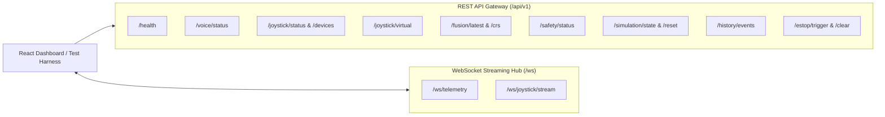

# FastAPI Backend & WebSocket API Specification

> **Document ID:** DCRG-ARCH-008  
> **Status:** Approved Architecture Draft (Phase 1)  
> **Framework:** FastAPI / Uvicorn / WebSockets

---

## 1. RESTful API Endpoints (`/api/v1`)

All endpoints return JSON responses compliant with standard HTTP status codes (`200 OK`, `400 Bad Request`, `403 Forbidden`, `422 Unprocessable Entity`, `500 Internal Error`).



### 1.1 Endpoint Directory

| Method | Route | Description | Auth / Gate Required |
| :--- | :--- | :--- | :--- |
| `GET` | `/api/v1/health` | Comprehensive system health, component status, active phase | None |
| `GET` | `/api/v1/voice/status` | Microphone status, active STT model, VAD metrics, recent transcript | None |
| `GET` | `/api/v1/joystick/status` | Current joystick modality, connection state, calibrated deadzone | None |
| `GET` | `/api/v1/joystick/devices` | Discovered physical USB/Bluetooth devices and hardware IDs | None |
| `POST` | `/api/v1/joystick/virtual` | Ingests a single virtual joystick frame (when not using WebSocket) | Validated schema |
| `GET` | `/api/v1/fusion/latest` | Latest graph alignment vector, component factor scores ($S, M, C$) | None |
| `GET` | `/api/v1/fusion/crs` | Real-time CRS score, veto status, and confidence metrics | None |
| `GET` | `/api/v1/safety/status` | Current authorization state (`GREEN`, `YELLOW`, `RED`, `EMERGENCY`) | None |
| `POST`| `/api/v1/safety/confirm`| Operator manual confirmation override for `YELLOW` holds | Operator Role |
| `GET` | `/api/v1/simulation/state`| Simulated robot pose $(x, y, \theta)$, velocities, boundary collisions | None |
| `POST`| `/api/v1/simulation/reset`| Resets simulated arena and robot position to origin $(0, 0, 0)$ | Dev / Sim Role |
| `GET` | `/api/v1/history/events` | Paginated query of synchronized events and safety decisions | None |
| `POST`| `/api/v1/estop/trigger` | Software emergency stop assertion (instant $O(1)$ lockout) | Open to all |
| `POST`| `/api/v1/estop/clear` | E-STOP manual clearance handshake | Multi-step handshake |

---

## 2. WebSocket Telemetry Streaming Hub

High-frequency telemetry (joystick vectors, robot positions, and CRS graph nodes) streams over duplex WebSockets to minimize HTTP header overhead.

### 2.1 Connection Endpoints
- `ws://localhost:8000/ws/telemetry`: Combined broadcast stream (50Hz) emitting fused state, CRS, safety state, and robot position to the React dashboard.
- `ws://localhost:8000/ws/joystick/stream`: Upstream client ingestion channel for virtual joystick and browser gamepad input frames.

### 2.2 Telemetry Packet Wire Formats

#### A. Outbound Telemetry Frame (`/ws/telemetry`)
Emitted at $50\text{ Hz}$ from backend to dashboard:

```json
{
  "packet_type": "TELEMETRY_FRAME",
  "sequence_id": 49201,
  "timestamp_ms": 1730851200150,
  "safety": {
    "state": "GREEN",
    "veto_asserted": false,
    "active_command": "FORWARD",
    "estop_tripped": false
  },
  "fusion": {
    "crs": 94.2,
    "semantic_score": 0.95,
    "motor_agreement": 0.98,
    "context_score": 1.00,
    "stress_score": 0.12,
    "angular_delta_deg": 4.5,
    "sync_latency_ms": 14.2
  },
  "inputs": {
    "voice_transcript": "MOVE FORWARD",
    "voice_confidence": 0.96,
    "joystick_x": 0.05,
    "joystick_y": 0.88,
    "joystick_direction": "FORWARD",
    "joystick_intensity": 0.88,
    "is_simulation": true
  },
  "robot_simulation": {
    "pos_x": 1.250,
    "pos_y": 3.410,
    "heading_deg": 12.4,
    "linear_vel": 0.704,
    "angular_vel": 0.050,
    "status": "MOVING"
  }
}
```

#### B. Inbound Virtual Joystick Frame (`/ws/joystick/stream`)
Transmitted at $50\text{ Hz}$ from React virtual joystick:

```json
{
  "packet_type": "JOYSTICK_INPUT",
  "client_id": "CLIENT-DASHBOARD-01",
  "timestamp_ms": 1730851200135,
  "axis_x": 0.05,
  "axis_y": 0.88,
  "buttons": [false, false, false, false],
  "is_simulation": true,
  "device_id": "VIRT-REACT-CANVAS"
}
```

