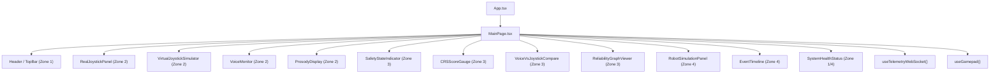

# React Operator Dashboard Architecture

> **Document ID:** DCRG-ARCH-010  
> **Status:** Approved Architecture Draft (Phase 1)  
> **Frontend Stack:** React 19 / TypeScript / Vite 8 / Tailwind CSS v4 / Recharts / Lucide

---

## 1. Visual Hierarchy & Grid Layout

The DCRG Engineering Dashboard provides a real-time, low-latency telemetry cockpit structured into four high-density operational zones:

```
+---------------------------------------------------------------------------------------------------+
| ZONE 1: TOP CONTROL BAR (DCRG Branding, Global Health, Mode: REAL/SIM, E-STOP Trigger, Latency)   |
+-------------------------------------------------+-------------------------------------------------+
| ZONE 2: INPUT MONITORING                        | ZONE 3: FUSION & SAFETY INTELLIGENCE            |
| - Real Joystick Hardware Panel (USB/BT status)  | - Live GREEN / YELLOW / RED / E-STOP Indicator  |
| - Virtual Joystick Canvas & WASD Controls       | - CRS Radial Gauge & Temporal Sparkline         |
| - Voice Monitor (VAD, Transcript, Confidence)   | - Vector Direction Comparison (Voice vs Stick)  |
| - Prosody Acoustic Waveform & Stress Meter      | - Dynamic Command Reliability Graph (Nodes/Edge)|
+-------------------------------------------------+-------------------------------------------------+
| ZONE 4: ROBOT SIMULATION & FORENSIC TIMELINE                                                      |
| - 2D Interactive Kinematics Arena (Robot Pose, Trajectory, Obstacles, Trail)                      |
| - Real-Time Synchronized Event & Audit Log Timeline                                               |
+---------------------------------------------------------------------------------------------------+
```

---

## 2. Component Hierarchy



---

## 3. The 12 Primary Dashboard Components

1. **`SystemOverview` / `Header`:** Global system heartbeat, backend connection status, operator profile, and prominent hardware E-STOP status badge.
2. **`RealJoystickPanel`:** Displays connected USB/Bluetooth controller name, vendor ID, axis deflections, button states, and live deadzone calibration graphics.
3. **`VirtualJoystickSimulator`:** High-frequency ($50\text{Hz}$) HTML5 Canvas touch/mouse pad and keyboard handler (WASD / arrows) with explicit **SIMULATION ONLY** badging.
4. **`VoiceCommandMonitor`:** Displays active VAD speech indicator, live Whisper transcript, lexical confidence bar, and timestamp.
5. **`VoiceVsJoystickCompare`:** Side-by-side polar radar chart showing angular alignment $\Delta \theta$ between vocal intent vector and physical joystick vector.
6. **`ProsodyAnalysisDisplay`:** Recharts acoustic line chart rendering fundamental frequency $F_0$ contour, jitter/shimmer levels, and composite stress dial ($S_{\text{stress}}$).
7. **`CRSScoreVisualization`:** Radial semi-circular gauge displaying the real-time CRS score ($0.0 - 100.0$) with color-coded safety thresholds ($<50$ Red, $50-84$ Yellow, $\ge 85$ Green).
8. **`ReliabilityGraph`:** Dynamic topological node visualization showing evidence edges linking acoustic stress, semantic confidence, and joystick intensity to the final decision.
9. **`SafetyStateIndicator`:** Massive, unambiguous color-coded status banner:
   - `GREEN` (Authorized & Moving)
   - `YELLOW` (Hold & Awaiting Confirmation)
   - `RED` (Contradiction Lockout)
   - `EMERGENCY` (Hard E-STOP Tripped)
10. **`RobotSimulationPanel`:** Canvas-based 2D planar arena rendering the differential-drive robot position $(x, y)$, heading heading arrow ($\theta$), past trajectory path, velocity vectors, and bounding walls.
11. **`EventTimeline`:** Continuous scrolling log of timestamped synchronized events, factor scores, and authorization verdicts.
12. **`SystemHealthStatus`:** Diagnostic drawer detailing WebSocket round-trip time (RTT), frame drop counts, audio buffer slip, and backend CPU/RAM utilization.

---

## 4. Visual Separation of Real Hardware vs Simulation

To prevent operator confusion between simulated test vectors and physical hardware:
- **Simulation Stream Badging:** Any component displaying simulated data (Virtual Joystick, Kinematics Arena) is bordered by an amber/cyan dashed outline and displays a persistent watermarked badge: `[SIMULATION ENGINE ACTIVE]`.
- **Physical Hardware Badging:** Hardware streams display a solid emerald/indigo badge: `[PHYSICAL HARDWARE: USB HID]`.

---

## 5. Non-Delegable Authority Rule
> **ABSOLUTE ARCHITECTURAL RULE:**
> The frontend **DISPLAYS** safety states and telemetry.
> The frontend **NEVER** computes authorization or issues motor commands directly.
> If the frontend UI crashes, closes, or disconnects, the backend Safety Engine detects WebSocket heartbeat loss within $150\text{ms}$ and initiates an automatic safe hold.

