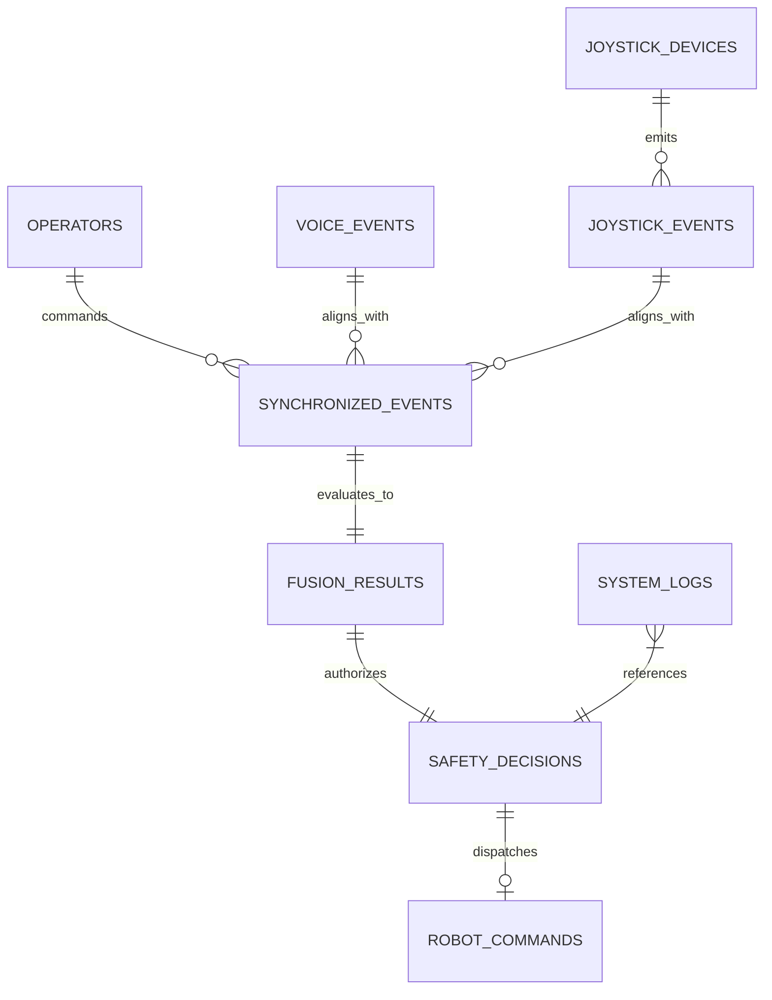

# SQLite Database Schema & Audit Trail Specification

> **Document ID:** DCRG-ARCH-009  
> **Status:** Approved Architecture Draft (Phase 1)  
> **Storage Engine:** SQLite 3 (WAL Mode Enabled)

---

## 1. Storage Strategy & Reliability Standards

To support rapid logging of high-frequency telemetry without blocking real-time control loops:
1. **Write-Ahead Logging (WAL Mode):** Enabled via `PRAGMA journal_mode = WAL; PRAGMA synchronous = NORMAL;`. Allows concurrent non-blocking reads during sustained $50\text{Hz}$ writes.
2. **Immutable Audit Trail:** Tables recording safety decisions, fusion results, and commands are strictly **append-only**. Updates and deletes are disallowed.
3. **Forensic Integrity:** Timestamps are recorded in millisecond Unix Epoch along with ISO-8601 UTC strings.



---

## 2. Table Schemas & Relational Specifications

### 2.1 Table: `operators`
Stores registered system operators and calibration profiles.

```sql
CREATE TABLE operators (
    operator_id TEXT PRIMARY KEY,               -- e.g. "OP-042"
    name TEXT NOT NULL,
    callsign TEXT UNIQUE NOT NULL,
    baseline_f0 REAL DEFAULT 130.0,             -- Calibrated mean pitch in Hz
    stress_threshold REAL DEFAULT 0.65,         -- Operator stress sensitivity
    created_at TIMESTAMP DEFAULT CURRENT_TIMESTAMP
);
```

### 2.2 Table: `joystick_devices`
Hardware registry of physical and virtual input controllers.

```sql
CREATE TABLE joystick_devices (
    device_id TEXT PRIMARY KEY,                 -- e.g. "USB-046d-c215"
    device_name TEXT NOT NULL,
    hardware_type TEXT NOT NULL,                -- "USB_FLIGHTSTICK", "BLUETOOTH_PAD", "VIRTUAL_WEB"
    axis_count INTEGER NOT NULL,
    button_count INTEGER NOT NULL,
    deadzone_radius REAL DEFAULT 0.08,
    is_simulation BOOLEAN NOT NULL DEFAULT 0,
    last_connected_at TIMESTAMP DEFAULT CURRENT_TIMESTAMP
);
```

### 2.3 Table: `voice_events`
Raw and transcribed vocal utterances.

```sql
CREATE TABLE voice_events (
    event_id TEXT PRIMARY KEY,                  -- UUIDv4
    operator_id TEXT REFERENCES operators(operator_id),
    timestamp_ms INTEGER NOT NULL,
    transcript TEXT NOT NULL,
    classified_intent TEXT NOT NULL,            -- "FORWARD", "BACKWARD", "LEFT", "RIGHT", "STOP", "UNKNOWN", "UNCERTAIN"
    stt_confidence REAL NOT NULL,               -- [0.0 - 1.0]
    pitch_f0 REAL,                              -- Ingested mean F0 in Hz
    jitter_percent REAL,                        -- Short-term pitch perturbation
    cognitive_stress_score REAL NOT NULL,       -- [0.0 - 1.0]
    audio_duration_ms INTEGER NOT NULL,
    created_at TIMESTAMP DEFAULT CURRENT_TIMESTAMP
);
CREATE INDEX idx_voice_timestamp ON voice_events(timestamp_ms);
```

### 2.4 Table: `joystick_events`
Ingested raw and normalized manual deflections.

```sql
CREATE TABLE joystick_events (
    event_id TEXT PRIMARY KEY,                  -- UUIDv4
    device_id TEXT REFERENCES joystick_devices(device_id),
    timestamp_ms INTEGER NOT NULL,
    axis_x REAL NOT NULL,                       -- Clamped [-1.000, +1.000]
    axis_y REAL NOT NULL,                       -- Clamped [-1.000, +1.000]
    direction TEXT NOT NULL,                    -- Classified direction
    intensity REAL NOT NULL,                    -- Polar radius [0.0 - 1.0]
    buttons_mask INTEGER DEFAULT 0,             -- Bitmask of pressed buttons
    is_simulation BOOLEAN NOT NULL,             -- Strict simulation tracking
    created_at TIMESTAMP DEFAULT CURRENT_TIMESTAMP
);
CREATE INDEX idx_joy_timestamp ON joystick_events(timestamp_ms);
```

### 2.5 Table: `synchronized_events`
Temporal alignment pairing linking concurrent voice and joystick events.

```sql
CREATE TABLE synchronized_events (
    sync_id TEXT PRIMARY KEY,                   -- UUIDv4
    voice_event_id TEXT REFERENCES voice_events(event_id),
    joystick_event_id TEXT REFERENCES joystick_events(event_id),
    timestamp_ms INTEGER NOT NULL,
    temporal_delta_ms REAL NOT NULL,            -- |t_voice - t_joy|
    alignment_status TEXT NOT NULL,             -- "ALIGNED", "ASYMMETRIC", "STALE_FALLBACK"
    created_at TIMESTAMP DEFAULT CURRENT_TIMESTAMP
);
```

### 2.6 Table: `fusion_results`
Mathematical outputs of the DCRG graph evaluation.

```sql
CREATE TABLE fusion_results (
    fusion_id TEXT PRIMARY KEY,                 -- UUIDv4
    sync_id TEXT REFERENCES synchronized_events(sync_id),
    timestamp_ms INTEGER NOT NULL,
    semantic_factor REAL NOT NULL,              -- S score [0.0 - 1.0]
    motor_factor REAL NOT NULL,                 -- M score [0.0 - 1.0]
    context_factor REAL NOT NULL,               -- C score [0.0 - 1.0]
    crs_score REAL NOT NULL,                    -- Scaled CRS [0.0 - 100.0]
    veto_asserted BOOLEAN NOT NULL,             -- Direct contradiction flag
    angular_delta_deg REAL NOT NULL,
    created_at TIMESTAMP DEFAULT CURRENT_TIMESTAMP
);
```

### 2.7 Table: `safety_decisions`
Deterministic state machine authorizations and safety gating records.

```sql
CREATE TABLE safety_decisions (
    decision_id TEXT PRIMARY KEY,               -- UUIDv4
    fusion_id TEXT REFERENCES fusion_results(fusion_id),
    timestamp_ms INTEGER NOT NULL,
    authorization_state TEXT NOT NULL,          -- "GREEN", "YELLOW", "RED", "EMERGENCY"
    is_authorized BOOLEAN NOT NULL,             -- 1 = Movement Allowed, 0 = Movement Denied
    denial_reason TEXT,                         -- e.g. "CONTRADICTION_VETO", "LOW_CRS", "STALE_TELEMETRY"
    auth_token TEXT,                            -- SHA256 token if authorized
    created_at TIMESTAMP DEFAULT CURRENT_TIMESTAMP
);
```

### 2.8 Table: `robot_commands`
Final physical/simulated actuation commands dispatched to gateways.

```sql
CREATE TABLE robot_commands (
    command_id TEXT PRIMARY KEY,                -- UUIDv4
    decision_id TEXT REFERENCES safety_decisions(decision_id),
    timestamp_ms INTEGER NOT NULL,
    target_gateway TEXT NOT NULL,               -- "SIMULATION", "PHYSICAL_SERIAL"
    motion_primitive TEXT NOT NULL,             -- "FORWARD", "BACKWARD", "LEFT", "RIGHT", "STOP"
    commanded_linear_vel REAL NOT NULL,
    commanded_angular_vel REAL NOT NULL,
    execution_status TEXT NOT NULL,             -- "EXECUTED", "REJECTED_BY_GATEWAY", "TIMED_OUT"
    is_simulation BOOLEAN NOT NULL,
    created_at TIMESTAMP DEFAULT CURRENT_TIMESTAMP
);
```

### 2.9 Table: `system_logs`
System security, heartbeats, disconnections, and fault events.

```sql
CREATE TABLE system_logs (
    log_id INTEGER PRIMARY KEY AUTOINCREMENT,
    timestamp_ms INTEGER NOT NULL,
    subsystem TEXT NOT NULL,                    -- "VOICE", "ACTUATOR", "FUSION", "SAFETY", "ESTOP"
    severity TEXT NOT NULL,                     -- "INFO", "WARNING", "CRITICAL", "FATAL"
    message TEXT NOT NULL,
    metadata JSON,
    created_at TIMESTAMP DEFAULT CURRENT_TIMESTAMP
);
```

