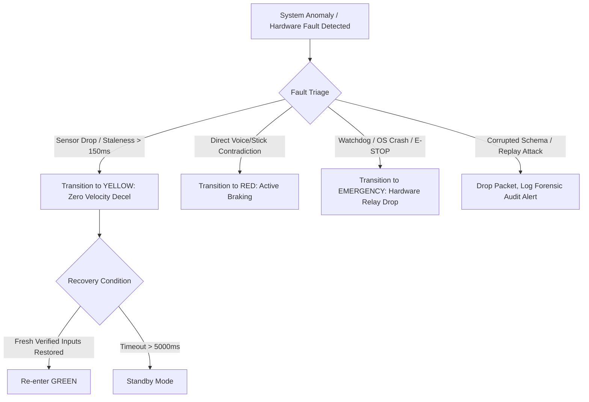

# Failure Handling & Security Architecture

> **Document ID:** DCRG-ARCH-012  
> **Status:** Approved Architecture Draft (Phase 1)  
> **Classification:** Fail-Safe Engineering & Security Protocols

---

## 1. Fail-Safe Engineering Philosophy

DCRG enforces a strict **Fail-Closed (Safe Hold)** posture across all architectural layers. Under any component crash, sensor disconnection, telemetry corruption, network drop, or software panic, the system **never** fails open (never authorizes unverified motion). It transitions deterministically to `YELLOW` (Neutral Hold), `RED` (Lockout), or `EMERGENCY` (Power Cut).

---

## 2. Comprehensive Fault Matrix & Mitigation Procedures

| Subsystem / Fault Condition | Root Cause Trigger | Detection Latency | Immediate Safe System Response | Recovery Protocol |
| :--- | :--- | :--- | :--- | :--- |
| **Microphone Hardware Loss** | USB disconnect, OS audio driver panic | $\le 100 \text{ ms}$ | VAD flags `AUDIO_ABSENT`. Invalidate speech pipeline. Downgrade safety state to `YELLOW`. | Hot-plug detection re-inits audio buffer; requires operator voice test. |
| **Joystick USB Interruption** | Cable yank, USB bus reset | $\le 40 \text{ ms}$ (2 frame skips) | Pygame raises `JOYDEVICEREMOVED`. Actuator engine zeroes $(x,y)$. State transitions to `YELLOW`. | Controller must be re-detected, centered, and pass neutral calibration. |
| **Bluetooth Signal Drop / Lag** | RF interference, battery depletion | $\le 60 \text{ ms}$ | Timestamp delta exceeds jitter threshold ($\Delta t > 100\text{ms}$). State transitions to `YELLOW`. | Operator must re-pair Bluetooth gamepad and verify zero deadzone. |
| **Backend Process Crash / OOM** | Out-of-memory or uncaught exception | $\le 50 \text{ ms}$ | Independent hardware watchdog timer trips when backend stops pinging. De-energizes motor relays. | Process supervisor (systemd / Windows Service) auto-restarts backend in standby. |
| **WebSocket Connection Drop** | Network disconnect, browser tab close | $\le 150 \text{ ms}$ | FastAPI connection manager notices heartbeat drop. Revokes active movement token immediately. | Client auto-reconnects with exponential backoff; re-synchronizes telemetry. |
| **SQLite Database Lock / Full** | Disk exhaustion, concurrent write lock | $\le 10 \text{ ms}$ | WAL mode fails over to in-memory circular ring buffer ($10,000$ events) to avoid blocking control. | Memory buffer flushes to disk when lock clears; emits administrative warning. |
| **Stale Sensor Timestamps** | Clock drift, thread starvation | $\le 1 \text{ ms}$ | Synchronization service drops any event with age $>150\text{ms}$. CRS drops to zero. | Host NTP / High-Precision Timer re-aligned. |
| **Malformed / Corrupted Frame** | Bit flip, fuzzing, buffer overrun | $\le 1 \text{ ms}$ | Pydantic validation error ($422$); packet discarded immediately; security alert logged. | Next valid frame evaluated normally. |
| **Replay / Duplicate Attack** | Duplicate `event_id` or replayed frame | $\le 1 \text{ ms}$ | Deduplication filter checks recent event cache; replayed event dropped instantly. | Replay flagged in audit trail; sender IP throttled. |
| **Unauthorized Actuator Injection** | Rogue client attempts to command motors | $\le 1 \text{ ms}$ | Gateway checks SHA-256 `auth_token`; rejects commands without valid backend signature. | IP address banned; emergency audit log generated. |

---

## 3. Basic Authentication & API Security Recommendations

Although DCRG is an internal teleoperation framework, security guardrails are essential to prevent lateral attacks across robotics networks:
1. **Mutual TLS (mTLS) / Localhost Binding:**
   - Production FastAPI endpoints bind strictly to loopback (`127.0.0.1`) unless explicitly configured with mTLS certificates for remote field stations.
2. **Ephemerality of Movement Authorization Tokens:**
   - Movement tokens generated by `safety_engine` expire within **$100\text{ ms}$** and are cryptographically signed using an HMAC-SHA256 secret generated at system boot.
3. **Role-Based API Segmentation:**
   - `OPERATOR`: Permitted to stream joystick/voice events and request confirmation.
   - `ADMIN / SAFETY_OFFICER`: Permitted to clear E-STOP lockouts, calibrate baseline $F_0$, and modify threshold configs.
   - `VIEWER`: Read-only access to `/ws/telemetry` for remote observation.
4. **WebSocket Heartbeat & Rate Limiting:**
   - Keepalive ping/pong frames required every $1000\text{ms}$.
   - Upstream rate limiter caps incoming joystick frames at $100\text{ Hz}$ to prevent client-induced denial of service.

