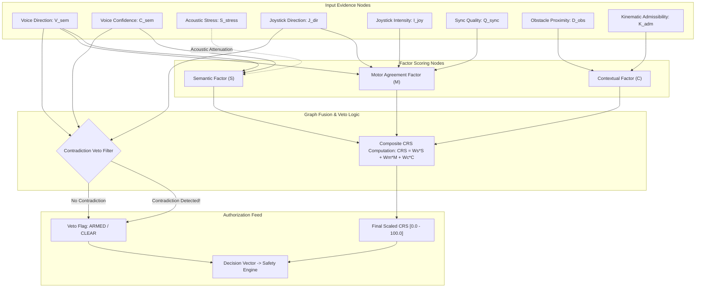

# DCRG Fusion Engine Mathematical & Logical Specification

> **Document ID:** DCRG-ARCH-005  
> **Status:** Approved Architecture Draft (Phase 1)  
> **Module Covered:** `fusion_engine`

---

## 1. Dynamic Command Reliability Graph (DCRG) Topology

The DCRG Fusion Engine treats command verification not as a naive black-box classifier, but as a directed graph representing evidence flow across heterogeneous modalities:

---

## 2. Mathematical Formulation of Factors

All component factors are normalized to the unit interval $[0.0, 1.0]$.

### 2.1 Semantic Factor ($S$)
Measures the acoustic clarity and confidence of the spoken utterance:
$$S = C_{\text{whisper}} \cdot (1.0 - \beta \cdot S_{\text{stress}})$$
- $C_{\text{whisper}} \in [0.0, 1.0]$: Probability assigned to the classified token by Faster-Whisper.
- $S_{\text{stress}} \in [0.0, 1.0]$: Normalized cognitive stress score from the Prosody Engine.
- $\beta = 0.25$: Stress damping coefficient. This ensures high stress modestly reduces semantic certainty without vetoing an otherwise clear command.
- **Defensive Clamp:** If token is `UNKNOWN` or `UNCERTAIN`, $S = 0.0$ strictly.

### 2.2 Motor / Actuator Agreement Factor ($M$)
Measures directional alignment between the normalized semantic vector $\vec{V}_{\text{sem}}$ and the normalized joystick vector $\vec{J}_{\text{norm}}$:
$$M = \frac{1 + \cos(\Delta \theta)}{2} \cdot \sqrt{I_{\text{joy}}} \cdot Q_{\text{sync}}$$
Where:
- $\cos(\Delta \theta) = \frac{\vec{V}_{\text{sem}} \cdot \vec{J}_{\text{norm}}}{\|\vec{V}_{\text{sem}}\| \|\vec{J}_{\text{norm}}\|}$ (Cosine similarity of direction vectors).
  - Exact match ($\Delta \theta = 0^\circ \implies \cos = 1.0$): Direction multiplier $= 1.0$.
  - Perpendicular ($\Delta \theta = 90^\circ \implies \cos = 0.0$): Direction multiplier $= 0.5$.
  - Exact contradiction ($\Delta \theta = 180^\circ \implies \cos = -1.0$): Direction multiplier $= 0.0$.
- $I_{\text{joy}} \in [0.0, 1.0]$: Physical deflection intensity.
- $Q_{\text{sync}} = \max\left(0.0, 1.0 - \frac{\Delta t}{\tau_{\text{sync}}}\right)$: Linear decay penalty for temporal misalignment within the synchronization window.

### 2.3 Contextual Consistency Factor ($C$)
Measures whether the requested movement is safe and physically executable given the robot's state:
$$C = K_{\text{kinematic}} \cdot \Omega_{\text{obstacle}}$$
- $K_{\text{kinematic}} \in \{0.0, 1.0\}$: $1.0$ if the command does not violate acceleration limits or dynamic tilt constraints; $0.0$ otherwise.
- $\Omega_{\text{obstacle}} \in [0.0, 1.0]$: Closeness penalty if commanded trajectory vectors toward a detected barrier within stopping distance $d_{\text{stop}}$.

---

## 3. Composite CRS Formulation & Experimental Weighting

### 3.1 Base Formula
$$\text{CRS}_{\text{raw}} = (W_s \cdot S) + (W_m \cdot M) + (W_c \cdot C)$$
$$\text{CRS} = \text{round}(100.0 \cdot \text{CRS}_{\text{raw}}, 1)$$
Subject to the constraint:
$$W_s + W_m + W_c = 1.0, \quad W_i \ge 0$$

### 3.2 Phase 1 Baseline Weighting & Calibration Protocol
> **ARCHITECTURAL NOTE:** The initial baseline weights below are **hypothetical design seeds** chosen for conservative verification:
> - $W_s = 0.35$ (Semantic Clarity Weight)
> - $W_m = 0.50$ (Motor Agreement Weight — physical control given higher prominence)
> - $W_c = 0.15$ (Contextual Admissibility Weight)
> 
> **These weights are NOT claimed to be scientifically or empirically validated.**
> During subsequent evaluation (Phase 10), weights will be formally calibrated through empirical receiver operating characteristic (ROC) curve analysis on recorded multi-operator command trials.

---

## 4. The Contradiction Veto Filter (The Zero-Override Law)

> **CORE SAFETY INTERLOCK:** A high numerical CRS score **CANNOT** override a direct safety contradiction.

Regardless of whether $\text{CRS} \ge 85.0$, if the following geometric contradiction predicate evaluates to `TRUE`:
$$\text{Contradiction}(\vec{V}_{\text{sem}}, \vec{J}_{\text{norm}}) \iff \left( \cos(\Delta \theta) \le 0.0 \land C_{\text{whisper}} \ge 0.70 \land I_{\text{joy}} \ge 0.30 \right)$$
Then:
1. The **VETO FLAG** is asserted: `veto_asserted = TRUE`.
2. The CRS is forcibly clamped to a maximum ceiling of $30.0$:
   $$\text{CRS} \leftarrow \min(\text{CRS}, 30.0)$$
3. The Safety Authorization Engine is compelled to bypass the `GREEN` state and enter `RED` (Command Hold).

### Contradiction Examples
| Voice Command | Joystick Vector $(x, y)$ | Cosine Sim $\cos(\Delta \theta)$ | Numerical CRS (Unclamped) | Veto Triggered? | Final Authorization |
| :--- | :--- | :--- | :--- | :--- | :--- |
| `"FORWARD"` | $(0.0, +0.9)$ | $+1.0$ ($0^\circ$) | $93.5$ | No | **GREEN (Authorized)** |
| `"FORWARD"` | $(+0.8, 0.0)$ [Right] | $0.0$ ($90^\circ$) | $61.2$ | No | **YELLOW (Hold & Confirm)** |
| `"FORWARD"` | $(0.0, -0.9)$ [Back] | $-1.0$ ($180^\circ$) | $28.0$ (or un-vetoed $50.0$) | **YES (VETO)** | **RED (Hazardous Contradiction)** |
| `"STOP"` | $(0.0, +0.8)$ [Moving] | $-1.0$ (Zero-tolerance) | $15.0$ | **YES (VETO)** | **RED (Immediate Halt)** |
| `"UNCERTAIN"`| $(0.0, +0.8)$ | N/A ($S=0.0$) | $45.0$ | No | **YELLOW (Hold & Confirm)** |

