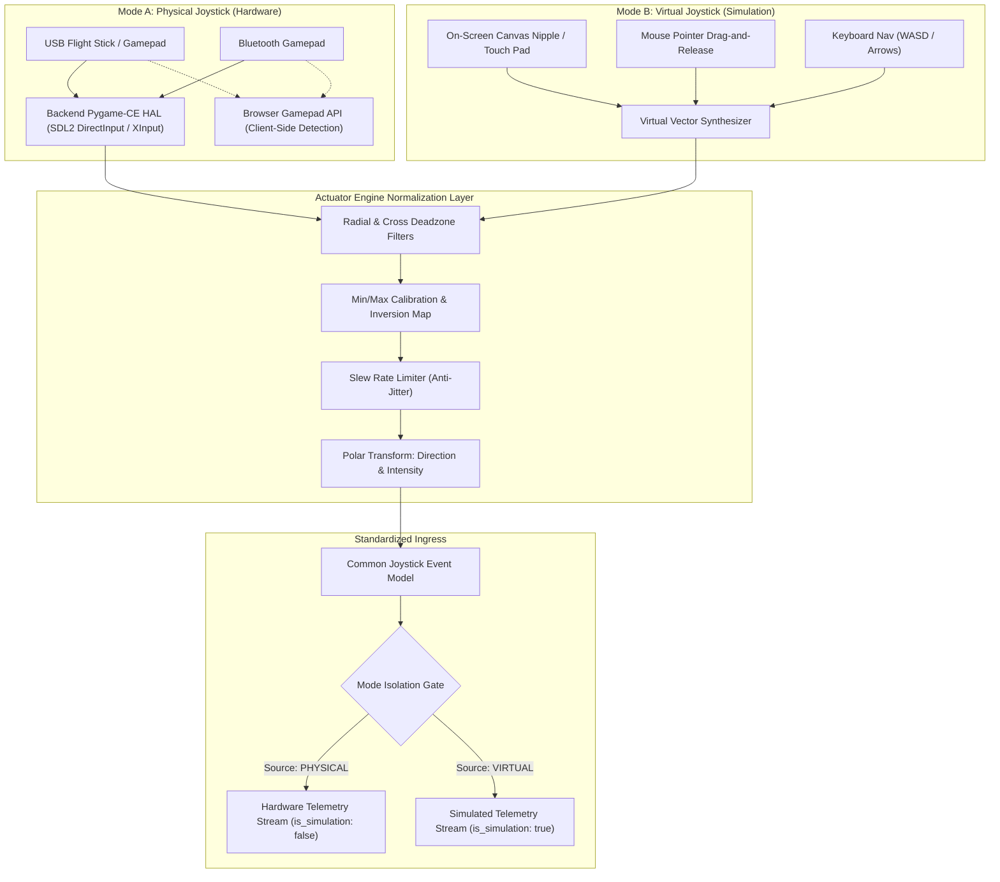

# Joystick Input Subsystem Architecture

> **Document ID:** DCRG-ARCH-003  
> **Status:** Approved Architecture Draft (Phase 1)  
> **Module Covered:** `actuator_engine`, Frontend Virtual Gamepad, Pygame HAL

---

## 1. Dual-Mode Input Architecture

The DCRG Actuator Subsystem accepts physical manual inputs through two strictly isolated ingress paths that converge on a **Common Joystick Event Contract**.



---

## 2. Mode A: Real Hardware Joystick Architecture

### 2.1 Hardware Discovery & Ingress Options
1. **Primary Backend Path (Direct Hardware Ingestion):**
   - Utilizes `pygame-ce` (`pygame.joystick`) inside `backend/app/hardware/`.
   - Polls physical HID events directly via SDL2 at $50\text{ Hz}$ ($20\text{ms}$ loop).
   - Immune to browser window focus loss, tab freezing, or Web Worker background throttling.
2. **Auxiliary Frontend Path (Browser Gamepad API):**
   - Implemented via `frontend/src/hooks/useGamepad.ts` using `navigator.getGamepads()`.
   - Serves immediate visual feedback on the operator dashboard.
   - Forwards client-side gamepad telemetry over WebSocket *only* when backend direct USB access is unavailable or when operating via remote web terminals.

### 2.2 Device Profiling & Configuration Management
Flight sticks, HOTAS throttles, and standard gamepads use divergent axis orderings (e.g., Logitech 3D Pro uses Axis 0 for Roll, Axis 1 for Pitch, Axis 2 for Yaw twist, and Axis 3 for Throttle; Xbox gamepads use Axis 0/1 for Left Stick and Axis 2/3 for Triggers).

DCRG implements a JSON-driven device profile registry (`config/joysticks/`):

```json
{
  "profile_name": "Logitech Extreme 3D Pro",
  "vendor_id": "046d",
  "product_id": "c215",
  "axes": {
    "x": { "index": 0, "inverted": false, "deadzone": 0.08 },
    "y": { "index": 1, "inverted": true, "deadzone": 0.08 },
    "twist_z": { "index": 2, "inverted": false, "deadzone": 0.12 },
    "throttle": { "index": 3, "inverted": false, "deadzone": 0.00 }
  },
  "buttons": {
    "trigger_fire": 0,
    "thumb_safety": 1,
    "estop_hardware_button": 11
  },
  "hats": {
    "pov_index": 0
  }
}
```

### 2.3 Signal Conditioning Algorithms
- **Radial Deadzone Calculation:**
  To prevent drifting when the joystick rests in the mechanical gimbal center:
  $$r = \sqrt{x^2 + y^2}$$
  $$\text{if } r < r_{\text{deadzone}} \implies x_{\text{filtered}} = 0,\; y_{\text{filtered}} = 0$$
  $$\text{else } \vec{J}_{\text{norm}} = \frac{\vec{J}}{r} \cdot \left( \frac{r - r_{\text{deadzone}}}{1.0 - r_{\text{deadzone}}} \right)$$
- **Slew-Rate Limiter:** Caps peak acceleration to prevent instantaneous synthetic step changes that damage mechanical gears:
  $$\Delta x_{\text{max}} = \dot{x}_{\text{limit}} \cdot \Delta t$$

---

## 3. Mode B: Virtual Joystick Architecture

### 3.1 Interaction Modalities
1. **Interactive Canvas Joystick (Mouse & Multi-Touch):**
   - Implemented as an HTML5 Canvas / SVG component in `frontend/src/joystick/VirtualJoystick.tsx`.
   - Clamped to an outer bounding circle with radius $R_{\text{pad}} = 80 \text{ px}$.
   - Spring-to-center mechanic: Pointer release instantly triggers damped spring return to $(0, 0)$ within $60\text{ms}$.
2. **Keyboard Emulation (WASD / Arrows):**
   - `W` / `Up Arrow`: Axis $Y = +1.0$ (Forward).
   - `S` / `Down Arrow`: Axis $Y = -1.0$ (Backward).
   - `A` / `Left Arrow`: Axis $X = -1.0$ (Left).
   - `D` / `Right Arrow`: Axis $X = +1.0$ (Right).
   - Compound chords (e.g. `W` + `D`): Normalized diagonal vector $(+0.707, +0.707)$.
   - Key release triggers instant zero-velocity transition.

### 3.2 Simulation Tagging & Hardware Quarantine
> **ABSOLUTE RULE:** Every event originating from the virtual joystick carries:
> ```json
> {
>   "source": "VIRTUAL_SIMULATION",
>   "is_simulation": true,
>   "device_id": "VIRT-JOYSTICK-001"
> }
> ```
> Any packet with `is_simulation: true` is strictly barred by the Safety Authorization Gateway from dispatching electrical signals to physical serial/CAN motor actuators.

---

## 4. Direction & Intensity Classification

Normalized Cartesian coordinates $(x, y) \in [-1.0, 1.0]$ are categorized into polar angles $\theta = \text{atan2}(y, x)$ and scalar intensity $I = \text{clamp}(\sqrt{x^2 + y^2}, 0.0, 1.0)$:

```mermaid
graph TD
    COORD["Cartesian Coordinates (x, y)"] --> POLAR["Polar Transform: (θ, I)"]
    POLAR --> CHECK_INT{"Intensity I > 0.15?"}
    
    CHECK_INT -->|No (In Deadzone)| DIR_STOP["Direction = STOP (0, 0)"]
    CHECK_INT -->|Yes| CHECK_ANGLE{"Evaluate Angle θ"}
    
    CHECK_ANGLE -->|45° ≤ θ < 135°| DIR_FWD["Direction = FORWARD"]
    CHECK_ANGLE -->|135° ≤ θ < 225°| DIR_LFT["Direction = LEFT"]
    CHECK_ANGLE -->|225° ≤ θ < 315°| DIR_BWD["Direction = BACKWARD"]
    CHECK_ANGLE -->|θ < 45° or θ ≥ 315°| DIR_RGT["Direction = RIGHT"]
```

---

## 5. Common Joystick Event Contract

Both physical and virtual pipelines emit the exact same data model to the Actuator Engine:

```typescript
export interface CommonJoystickEvent {
  event_id: string;                      // UUIDv4
  source: 'PHYSICAL_HARDWARE' | 'VIRTUAL_SIMULATION';
  is_simulation: boolean;                // true for virtual, false for physical
  device_id: string;                     // e.g. "USB-046d-c215" or "VIRT-BROWSER-001"
  timestamp_ms: number;                  // Unix Epoch in milliseconds
  axis_x: number;                        // Float [-1.000 to +1.000] (Left: -1, Right: +1)
  axis_y: number;                        // Float [-1.000 to +1.000] (Back: -1, Fwd: +1)
  direction: 'FORWARD' | 'BACKWARD' | 'LEFT' | 'RIGHT' | 'STOP';
  intensity: number;                     // Float [0.000 to 1.000]
  buttons: boolean[];                    // Array of digital button states [b0, b1, ...]
  pov_hat: { x: number; y: number };     // Directional pad (-1, 0, 1)
  connection_status: 'CONNECTED' | 'DISCONNECTED' | 'DEGRADED';
  calibration_status: 'CALIBRATED' | 'UNCALIBRATED' | 'DEFAULT';
  data_validity: 'VALID' | 'STALE' | 'CORRUPTED';
}
```

