# Robot Simulation Gateway Architecture

> **Document ID:** DCRG-ARCH-007  
> **Status:** Approved Architecture Draft (Phase 1)  
> **Module Covered:** `simulation`, Robot Kinematics Gateway

---

## 1. Simulation Subsystem Overview

The DCRG Robot Simulation Gateway provides a deterministic, real-time 2D planar kinematics simulation of a non-holonomic differential-drive mobile robot. It serves as the primary verification target during development, allowing full end-to-end multi-modal testing without physical hazard.

```mermaid
flowchart LR
    SAFETY[Safety Authorization Gateway] -->|Signed Motion Command| SIM_GATE[Simulation Gateway]
    
    subgraph KINEMATICS ["2D Robot Kinematics Simulator (50Hz)"]
        DIFF_DRIVE[Differential Drive Model]
        INTEG[Numerical Euler/Runge-Kutta Integrator]
        BOUNDS[Arena Boundary & Collision Detector]
    end

    subgraph STATE ["Robot State Store"]
        POS["Position: (x, y) meters"]
        HEAD["Heading: θ radians / degrees"]
        VEL["Velocities: Linear v (m/s), Angular ω (rad/s)"]
        HIST["Circular Command History Buffer"]
    end

    SIM_GATE --> DIFF_DRIVE --> INTEG --> BOUNDS
    BOUNDS --> STATE
    STATE -->|State Broadcast JSON| WS[WebSocket Telemetry Hub]
    STATE -->|Obstacle / Kinematic Feedback| CTX[Context Engine]
```



---

## 2. Mathematical Kinematic Model

The simulated robot operates as a unicycle / differential-drive platform parameterized by track width $L = 0.35 \text{ m}$ and wheel radius $R = 0.05 \text{ m}$:

$$\begin{bmatrix} \dot{x} \\ \dot{y} \\ \dot{\theta} \end{bmatrix} = \begin{bmatrix} \cos(\theta) & 0 \\ \sin(\theta) & 0 \\ 0 & 1 \end{bmatrix} \begin{bmatrix} v \\ \omega \end{bmatrix}$$

Where:
- $v \in [-0.8, +0.8] \text{ m/s}$: Linear forward/backward velocity.
- $\omega \in [-2.0, +2.0] \text{ rad/s}$: Angular turning rate.

### Discrete Time Integration ($50\text{ Hz}$, $\Delta t = 0.02\text{ s}$):
$$x_{k+1} = x_k + v_k \cdot \cos(\theta_k) \cdot \Delta t$$
$$y_{k+1} = y_k + v_k \cdot \sin(\theta_k) \cdot \Delta t$$
$$\theta_{k+1} = \theta_k + \omega_k \cdot \Delta t$$

---

## 3. Strict Gateway Interlock

> **UNCOMPROMISING RULE:** The simulation engine **NEVER** accepts raw commands from the frontend, virtual joystick, or raw voice STT directly.

Every command accepted by `SimulationGateway.execute_command()` must carry an authentic authorization payload:
```python
class AuthorizedRobotCommand(BaseModel):
    command_id: UUID
    timestamp: float
    authorization_state: Literal["GREEN"]  # Must be strictly GREEN
    auth_token: str                       # Ephemeral SHA-256 token signed by safety_engine
    linear_velocity: float                # Normalized [-1.0, 1.0]
    angular_velocity: float               # Normalized [-1.0, 1.0]
    motion_primitive: Literal["FORWARD", "BACKWARD", "LEFT", "RIGHT", "STOP"]
    is_simulation: Literal[True]          # Always True for simulated execution
```

If the `authorization_state` is anything other than `GREEN`, the gateway forcibly overrides linear and angular velocity to $(0.0, 0.0)$, executing controlled decel.

---

## 4. Simulation Behavior Under Operational Scenarios

| Scenario | System State | Simulator Response | Visual Indicator |
| :--- | :--- | :--- | :--- |
| **Voice & Joystick Agree** | `GREEN` | Smooth motion along commanded trajectory with acceleration ramping. | Solid Emerald Robot Glow |
| **Voice & Joystick Contradict** | `RED` | Instant zero-velocity brake. Robot halts within $40\text{ms}$. Position frozen. | Flashing Crimson Hazard Box |
| **Voice Unclear / Uncertain** | `YELLOW` | Robot glides to a stop ($0.0 \text{ m/s}$). Holds position until confirmed. | Amber Caution Pulse |
| **Joystick Disconnection** | `YELLOW` / `RED` | Heartbeat loss detected within $100\text{ms}$; instant active braking. | Disconnected Badge Displayed |
| **Stale Telemetry Data** | `YELLOW` | If packet age $>150\text{ms}$, position halts immediately. | Clock Stale Warning Flag |
| **Emergency Stop (E-STOP)** | `EMERGENCY` | Hard cut. Velocity set to $0.0$ instantly without deceleration smoothing. | Full Red Screen Lockout |

