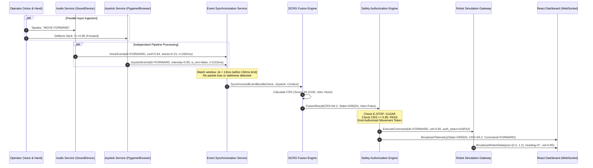

# DCRG System Architecture & Technical Specification

> **Document ID:** DCRG-ARCH-001  
> **Status:** Approved Architecture Draft (Phase 1)  
> **System Classification:** AI + IoT Command Verification & Safety Authorization Framework

---

## 1. Executive Summary & Core Mission

The **Dynamic Command Reliability Graph (DCRG)** is an asynchronous, dual-pipeline verification framework engineered to prevent fatal control divergence in teleoperated robotics. In mission-critical robotics, manual controls (joysticks) and natural language controls (voice) provide complementary affordances. However, under high cognitive stress, operators frequently experience intention-action mismatch (e.g., vocalizing *"STOP"* while reflexively leaning on the joystick, or commanding *"MOVE FORWARD"* while deflecting the stick backward).

DCRG captures both input modalities concurrently, ingests them into independent extraction pipelines, temporally aligns the resulting event streams within a deterministic sliding window, constructs an interconnected **Command Reliability Graph**, calculates a **Cross-Reliability Score (CRS)**, and subjects all motion requests to a **Tiered Safety Authorization Engine** prior to transmission to physical or simulated actuators.

```mermaid
flowchart TB
    subgraph SENSORS ["Operator Ingestion Layer"]
        MIC["Audio Ingestion (Microphone)"]
        JOY_REAL["Physical Joystick (USB / Bluetooth)"]
        JOY_VIRT["Virtual Joystick (Web Dashboard)"]
    end

    subgraph PIPELINES ["Independent Processing Pipelines"]
        direction TB
        subgraph VOICE_PIPE ["Voice Processing Subsystem"]
            VE["Voice Engine (Faster-Whisper STT)"]
            PE["Prosody Engine (Librosa Acoustic DSP)"]
            SE["Semantic Engine (NLP Intent Classifier)"]
        end
        subgraph ACT_PIPE ["Actuator Processing Subsystem"]
            AE["Actuator Engine (Pygame / Gamepad API)"]
            CALIB["Calibration, Deadzone & Normalization"]
        end
    end

    subgraph SYNC_FUSION ["Temporal Synchronization & Graph Fusion Layer"]
        SYNC["Event Synchronization Service (Sliding Buffer)"]
        FE["DCRG Fusion Engine (CRS Calculator)"]
        CTX["Context Engine (Pose, Velocity, Obstacles)"]
    end

    subgraph SAFETY_LAYER ["Deterministic Safety Authorization Layer"]
        SEng["Tiered Safety Authorization Engine (State Machine)"]
        ESTOP["Independent Hardware / OS Emergency Stop (E-STOP)"]
        GATE["Safety Authorization Gateway"]
    end

    subgraph ACTUATION ["Actuation & Observability Layer"]
        SIM_GATE["Robot Simulation Gateway (Kinematics)"]
        PHY_GATE["Physical Hardware Gateway (Serial / CAN - Guarded)"]
        DB[(SQLite WAL Audit Trail)]
        DASH["React Engineering Dashboard (WebSockets)"]
    end

    %% Sensor to Pipeline flows
    MIC --> VE --> SE
    MIC --> PE
    JOY_REAL --> AE
    JOY_VIRT --> AE
    AE --> CALIB

    %% Pipeline to Sync
    SE -->|Semantic Command Event| SYNC
    PE -->|Prosody Stress Event| SYNC
    CALIB -->|Normalized Joystick Event| SYNC

    %% Sync to Fusion
    SYNC -->|Synchronized Event Matrix| FE
    CTX -->|Operational Context Vector| FE

    %% Fusion to Safety
    FE -->|Command Reliability Score + Vector Graph| SEng
    ESTOP -->|Hardware Interrupt Override (O(1))| SEng
    SEng --> GATE

    %% Authorization to Outputs
    GATE -->|Authorized Simulation Command| SIM_GATE
    GATE -.->|Phase 9 Guarded Hardware Link| PHY_GATE
    GATE -->|Immutable Forensic Record| DB
    GATE -->|Live Real-Time Telemetry| DASH
    SIM_GATE -->|State Feedback| CTX
    SIM_GATE -->|Telemetry Stream| DASH
```

---

## 2. Six Major DCRG Engines

The core processing tier of DCRG is structured into six high-cohesion, low-coupling modules located in `backend/app/modules/`:

### 2.1 Prosody Analysis Engine (`prosody_engine`)
- **Responsibility:** Ingests raw audio PCM streams, extracts acoustic features (Fundamental frequency $F_0$, RMS intensity, pitch delta, jitter, and speech rate), and outputs a normalized cognitive stress metric $S_{\text{stress}} \in [0.0, 1.0]$.
- **Design Rule:** Vocal stress is treated strictly as an **attenuation or confidence-weighting factor**. High vocal stress alone *never* invalidates a command, nor does calm prosody authorize a contradictory command.

### 2.2 Semantic Coherence Engine (`semantic_engine`)
- **Responsibility:** Ingests textual transcripts emitted by Faster-Whisper, performs token-level semantic classification against the predefined lexicon (`LEFT`, `RIGHT`, `FORWARD`, `BACKWARD`, `STOP`), and outputs a structured semantic command vector with confidence $C_{\text{sem}} \in [0.0, 1.0]$.
- **Fallback States:** Explicitly generates `UNKNOWN` (unrecognized token) or `UNCERTAIN` (low acoustic/language confidence), preventing hallucinatory inference.

### 2.3 Actuator / Haptic Engine (`actuator_engine`)
- **Responsibility:** Ingests raw deflection vectors from physical USB/Bluetooth joysticks (via Pygame) and virtual browser inputs (via Gamepad API or on-screen touch/WASD controls).
- **Core Operations:** Center deadzone masking, polar coordinate transformation $(\theta, r)$, axis remapping, slew-rate limiting, and generation of a standardized normalized joystick vector $\vec{J} = (x, y, \text{intensity}, \text{direction})$.

### 2.4 DCRG Fusion Engine (`fusion_engine`)
- **Responsibility:** Dynamically binds synchronized voice, prosody, actuator, and contextual events into a directed reliability graph. Computes the composite **Cross-Reliability Score (CRS)**:
  $$\text{CRS} = W_s \cdot S + W_m \cdot M + W_c \cdot C$$
- **Safety Interlock:** Applies an instantaneous **Contradiction Veto Filter**: if semantic vector direction and joystick physical direction exhibit an angular divergence $\Delta \theta \ge 90^\circ$ with high individual confidences, CRS is forcibly held or downgraded, triggering a safety hold.

### 2.5 Tiered Safety Authorization Engine (`safety_engine`)
- **Responsibility:** Evaluates incoming commands against a deterministic 4-state finite state machine (`GREEN`, `YELLOW`, `RED`, `EMERGENCY`).
- **Authorization Authority:** Sole component in the entire architecture permitted to issue signed movement tokens to actuators. Operates strictly on trusted backend compute.

### 2.6 Baseline and Context Engine (`context_engine`)
- **Responsibility:** Maintains the running operational context of the robot (current velocity, heading, proximity to virtual/physical obstacles, battery state, and historical command trajectory). Ensures commands are physically admissible within the operational environment.

---

## 3. Infrastructure & Communication Architecture



### 3.1 Network Topology & Latency Budget
To maintain real-time responsiveness and avoid human-perceptible lag in teleoperation, DCRG operates within a strict total system latency budget:

| Processing Stage | Target Latency | Max Allowable Latency | Fallback Behavior on Exceedance |
| :--- | :--- | :--- | :--- |
| Audio Ingestion & VAD | 20 ms | 40 ms | Audio buffer drop, log frame slip |
| Faster-Whisper Transcription | 45 ms | 80 ms | Emit `UNCERTAIN` event tag |
| Librosa Prosody Extraction | 15 ms | 30 ms | Default to neutral stress ($S_{\text{stress}}=0.5$) |
| Joystick Pygame / Gamepad Polling | 5 ms | 10 ms | Retain last valid sample if $<20\text{ms}$ |
| Event Synchronization Matching | 5 ms | 10 ms | Expire mismatched events to `HOLD` |
| DCRG Graph Fusion & CRS Calculation | 5 ms | 10 ms | Default CRS to $0.0$, Hold |
| Safety State Machine Evaluation | 1 ms | 2 ms | Deterministic $O(1)$ fail-safe transition |
| WebSocket Telemetry Broadcast | 10 ms | 25 ms | Drop non-critical visual frames |
| **Total End-to-End Latency** | **106 ms** | **207 ms** | **Trigger Safe Hold if $>150\text{ms}$** |

---

## 4. Architectural Boundaries and Non-Negotiable Separation

1. **Hardware vs Simulation Airgap:**
   - Real hardware actuator packets are generated exclusively within `backend/app/hardware/`.
   - Simulation commands exist in `backend/app/simulation/` and carry explicit metadata `is_simulation: true`.
   - Simulation commands cannot cross into serial UART or CAN bus controllers under any circumstance.
2. **Frontend Zero-Authorization Authority:**
   - The React frontend is purely an observation, interaction, and virtual joystick generation surface.
   - The frontend never evaluates safety rules, never emits actuator drive pulses, and cannot authorize movement.
3. **Emergency Stop (E-STOP) Architecture:**
   - The E-STOP path is completely out-of-band from AI inference.
   - It runs as an asynchronous hardware interrupt or high-priority OS signal listener directly in the safety state machine, terminating motor permissions synchronously within $<1\text{ms}$.

