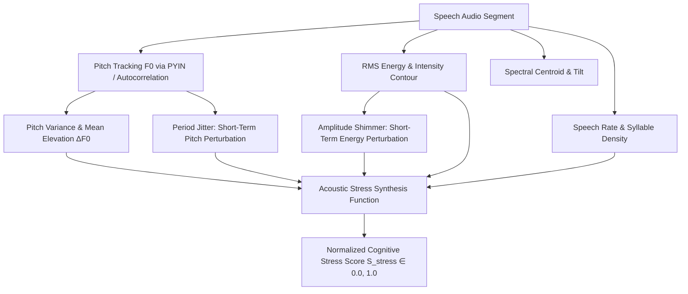

# Voice Processing Pipeline Architecture

> **Document ID:** DCRG-ARCH-002  
> **Status:** Approved Architecture Draft (Phase 1)  
> **Modules Covered:** `voice_engine`, `prosody_engine`, `semantic_engine`

---

## 1. Pipeline Overview

The DCRG Voice Processing Pipeline converts unstructured continuous acoustic pressure waves captured by an operator microphone into structured, timestamped, and stress-annotated **Voice Events**.

```mermaid
flowchart LR
    MIC[Microphone Input] --> CAP[Audio Capture Buffer 16kHz PCM]
    CAP --> VAD[Voice Activity Detection Silero/WebRTC]
    
    VAD -->|Speech Segment| SPLIT{Pipeline Split}
    
    SPLIT -->|Raw Audio Chunk| PROS[Prosody Analysis Engine]
    SPLIT -->|Preprocessed Audio| STT[Faster-Whisper STT]
    
    PROS -->|F0, Energy, Jitter, Shimmer| STRESS[Cognitive Stress Scorer]
    STT -->|Transcript + Word Timestamps| SEM[Semantic Coherence Engine]
    
    SEM -->|Intent & Direction Vector| FUSE_EVENT[Voice Event Assembler]
    STRESS -->|Stress Multiplier| FUSE_EVENT
    
    FUSE_EVENT -->|Standardized Voice Event| SYNC[Event Synchronization Service]
```

---

## 2. Audio Capture & Preprocessing

### 2.1 Ingestion Specifications
- **Sampling Rate:** $16,000 \text{ Hz}$ (Native target for Whisper models).
- **Format:** 16-bit signed Linear PCM, Single-Channel (Mono).
- **Chunk Size / Frame Length:** $30 \text{ ms}$ (480 samples per frame) for streaming VAD.
- **Ring Buffer Size:** 3.0 seconds circular buffer to support real-time sliding context.

### 2.2 Noise Reduction & Speech Conditioning
- **High-Pass Filtering:** 4th-order Butterworth digital filter with cutoff $f_c = 80 \text{ Hz}$ to eliminate mechanical hum and HVAC sub-bass rumble.
- **Dynamic Spectral Subtraction:** Background noise estimation sampled during non-speech intervals ($VAD = 0$) and subtracted from incoming spectral magnitude bins.
- **Automatic Gain Control (AGC):** Normalizes RMS amplitude to $-20 \text{ dBFS}$ to prevent clipping distortion when operators shout or acoustic drop when operators whisper.

### 2.3 Voice Activity Detection (VAD)
- Integrated Silero-VAD running locally with low CPU overhead ($<1\text{ms}$ per chunk).
- Trigger threshold: Speech probability $> 0.65$.
- Hangover duration: $250 \text{ ms}$ silence required before closing speech segment, ensuring compound commands (e.g. *"Robot, stop now"*) are not fragmented.

---

## 3. Speech-to-Text Pipeline (Faster-Whisper)

### 3.1 Model Architecture & Optimization
- **Inference Engine:** `faster-whisper` based on CTranslate2 quantized execution.
- **Default Model Tier:** `base.en` (or `small.en` when GPU acceleration is available).
- **Quantization:** `int8` for fast CPU execution on Windows/Linux host platforms with inference latency $<50\text{ms}$.
- **Beam Search & Decoding Constraints:**
  - `beam_size = 1` (Greedy search for ultra-low latency; sufficient given constrained vocabulary).
  - Restricted lexical prompt: *Pre-conditioned with control vocabulary prompt* to bias decoder logits toward command primitives.

### 3.2 Predefined Command Set & Formal Lexicon

The speech system maps operator utterances into five canonical operational primitives and two defensive states:

| Canonical Command | Standard Utterances | Semantic Vector $\vec{V}_{\text{sem}} = (x, y)$ | Action Classification |
| :--- | :--- | :--- | :--- |
| **`FORWARD`** | "Forward", "Move forward", "Ahead", "Go straight" | $(0.0, +1.0)$ | Linear Translation ($+Y$) |
| **`BACKWARD`** | "Backward", "Reverse", "Back up", "Go back" | $(0.0, -1.0)$ | Linear Translation ($-Y$) |
| **`LEFT`** | "Left", "Turn left", "Steer left", "Move left" | $(-1.0, 0.0)$ | Angular Rotation / Lateral ($-X$) |
| **`RIGHT`** | "Right", "Turn right", "Steer right", "Move right" | $(+1.0, 0.0)$ | Angular Rotation / Lateral ($+X$) |
| **`STOP`** | "Stop", "Halt", "Freeze", "Brake", "Hold position" | $(0.0, 0.0)$ | Zero-Velocity Actuation Hold |
| **`UNKNOWN`** | Utterance recognized but outside lexicon (e.g. "Hello") | $(0.0, 0.0)$ | Non-Actionable State |
| **`UNCERTAIN`** | Acoustic energy detected but STT confidence below threshold | $(0.0, 0.0)$ | Ambiguous State (Yields YELLOW) |

---

## 4. Prosody Analysis & Cognitive Stress Scoring

Prosodic indicators are extracted from the raw speech frame using `librosa` or `parselmouth` (Praat wrapper) concurrently with STT processing.

### 4.1 Feature Extraction Matrix

1. **Fundamental Frequency ($F_0$):**
   - Tracked via pYIN (probabilistic YIN) or Yin algorithm.
   - Evaluated against operator baseline $\bar{F}_{0,\text{calibrated}}$. Elevated pitch ($+20\%$ to $+50\%$) strongly correlates with acute sympathetic nervous system arousal.
2. **Jitter & Shimmer:**
   - **Jitter (local):** Cycle-to-cycle perturbation of pitch period ($\% \text{ jitter} > 1.5\%$ indicates vocal cord micro-tremor).
   - **Shimmer (local):** Cycle-to-cycle perturbation of vocal amplitude ($\% \text{ shimmer} > 3.0\%$).
3. **Speech Rate & Syllabic Density:**
   - Syllables per second calculated via energy peak envelope. Rapid speech bursts ($>6.5 \text{ syllables/sec}$) or extreme hesitation gaps ($>1.2\text{s}$) signal cognitive distress.

### 4.2 Composite Stress Score Calculation
$$S_{\text{stress}} = \sigma\left( \alpha_1 \frac{F_0 - \bar{F}_0}{\sigma_{F_0}} + \alpha_2 \frac{J - \bar{J}}{\sigma_J} + \alpha_3 \frac{Sh - \overline{Sh}}{\sigma_{Sh}} + \alpha_4 \frac{I - \bar{I}}{\sigma_I} \right)$$
Where $\sigma(z) = \frac{1}{1 + e^{-z}}$ scales the normalized deviation to $[0.0, 1.0]$. Default weights: $\alpha_1=0.4, \alpha_2=0.2, \alpha_3=0.2, \alpha_4=0.2$.

### 4.3 Mandatory Safety Rule for Prosody
> **BINDING GUARDRAIL:** Vocal stress is strictly an **attenuation and contextual indicator**.
> - A high stress score ($S_{\text{stress}} > 0.7$) indicates the operator may be experiencing panic, causing the Fusion Engine to require higher manual joystick correlation.
> - A low stress score ($S_{\text{stress}} < 0.2$) **never** authorizes contradictory manual movements.
> - An operator in a crisis shouting *"STOP"* with elevated stress must trigger **immediate emergency halt**, not a rejection due to stress.

---

## 5. Handling Degraded Speech and Fault Conditions

| Failure Mode | Detection Mechanism | Immediate Pipeline Response | Output State |
| :--- | :--- | :--- | :--- |
| **Unclear / Garbled Speech** | Faster-Whisper avg logprob $< -1.0$ or word confidence $< 0.60$ | Reject intent classification; tag as uncertain | `UNCERTAIN` |
| **Background Noise / Cross-talk** | SNR $< 6 \text{ dB}$ or spectral centroid $> 4500 \text{ Hz}$ with no harmonic structure | Discard frame; suppress false command trigger | `UNKNOWN` |
| **Microphone Hardware Loss** | Zero audio frames received over $100\text{ms}$ or OS input disconnect | Mark audio service offline; set voice status `DISCONNECTED` | `DISCONNECTED` |
| **Delayed Voice Events** | Event timestamp $t_{\text{event}} < t_{\text{current}} - 200\text{ms}$ | Drop stale event; emit warning log to audit trail | `DROPPED_STALE` |
| **Out-of-Vocabulary Utterance** | Levenshtein distance to all commands $> 3$ tokens | Classify as non-actionable; no motion permitted | `UNKNOWN` |

