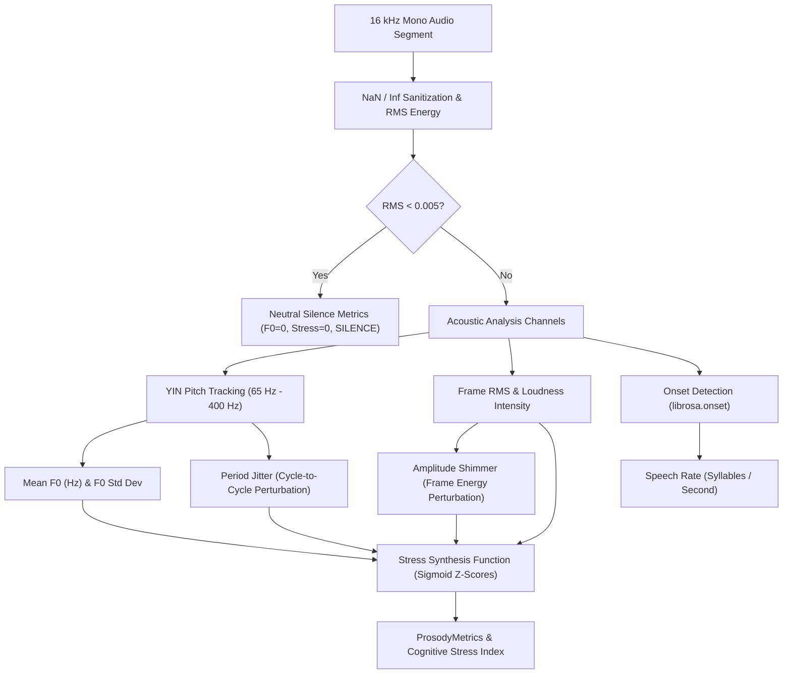

# Prosody Analysis & Acoustic Stress Extraction Specification

> **Document ID:** DCRG-DOC-P3-003  
> **Status:** Completed Phase 3 Deliverable  
> **Modules Covered:** `backend/app/modules/prosody_engine/analyzer.py`

---

## 1. Feature Extraction Methodology

The Prosody Analysis Engine computes real-time acoustic indicators directly from raw 16 kHz Linear PCM speech segments using `librosa` and digital signal processing routines.

---

## 2. Mathematical Formulations

### 2.1 Fundamental Frequency ($F_0$) via YIN
The YIN pitch estimator is executed with:
- Search bounds: $f_{\min} = 65 \text{ Hz}$, $f_{\max} = 400 \text{ Hz}$ (encompassing adult human vocal registers from bass to shouting soprano).
- Frame length: 2,048 samples; Hop length: 512 samples.
- Voiced frames are filtered:
  $$\text{Voiced} = \{ F_{0,i} \mid 65.0 \le F_{0,i} \le 400.0 \}$$
- Mean fundamental frequency:
  $$\bar{F}_0 = \frac{1}{N} \sum_{i=1}^{N} F_{0,i}$$

### 2.2 Period Jitter (Short-Term Pitch Perturbation)
Jitter quantifies the instability of vocal fold vibration period $T_i = \frac{1}{F_{0,i}}$ across consecutive voiced cycles:
$$\text{Jitter}_{\text{local}} = \frac{\frac{1}{N-1} \sum_{i=1}^{N-1} |T_i - T_{i+1}|}{\frac{1}{N} \sum_{i=1}^{N} T_i}$$
*Normal speech jitter is typically $0.5\% - 1.5\%$; elevated micro-tremor under acute stress rises above $2.5\%$.*

### 2.3 Amplitude Shimmer (Short-Term Energy Perturbation)
Shimmer measures cycle-to-cycle or frame-to-frame variations in vocal amplitude $A_i$:
$$\text{Shimmer}_{\text{local}} = \frac{\frac{1}{N-1} \sum_{i=1}^{N-1} |A_i - A_{i+1}|}{\frac{1}{N} \sum_{i=1}^{N} A_i}$$
*Normal vocal shimmer is typically $2.0\% - 4.0\%$.*

### 2.4 Speech Rate & Syllabic Density
Estimated using energy onset envelope peaks over the audio segment duration:
$$\text{Speech Rate} = \min\left(15.0, \max\left(0.0, \frac{N_{\text{onsets}}}{\Delta t_{\text{sec}}}\right)\right)$$
*Normal conversational speech tempo resides between $3.0$ and $5.5 \text{ syllables/second}$.*

### 2.5 Intensity and Loudness
$$\text{RMS} = \sqrt{\frac{1}{M} \sum_{n=1}^{M} x[n]^2}$$
$$\text{Intensity}_{\text{dBFS}} = 20 \log_{10}\left(\max\left(\text{RMS}, 10^{-6}\right)\right)$$
$$\text{Intensity}_{\text{norm}} = \min(1.0, \max(0.0, \text{RMS} \times 4.0))$$

---

## 3. Cognitive Stress Score Synthesis

Per **DCRG-ARCH-002**, the normalized acoustic cognitive stress index $S_{\text{stress}} \in [0.0, 1.0]$ is computed as:

$$z = \alpha_1 \left(\frac{\bar{F}_0 - \bar{F}_{0,\text{base}}}{\sigma_{F_0}}\right) + \alpha_2 \left(\frac{J - \bar{J}_{\text{base}}}{\sigma_J}\right) + \alpha_3 \left(\frac{Sh - \overline{Sh}_{\text{base}}}{\sigma_{Sh}}\right) + \alpha_4 \left(\frac{I - \bar{I}_{\text{base}}}{\sigma_I}\right)$$

$$S_{\text{stress}} = \frac{1}{1 + e^{-z}}$$

### Default Calibration Baselines
- $\bar{F}_{0,\text{base}} = 160.0 \text{ Hz}$, $\sigma_{F_0} = 50.0 \text{ Hz}$
- $\bar{J}_{\text{base}} = 0.012$ ($1.2\%$), $\sigma_J = 0.010$
- $\overline{Sh}_{\text{base}} = 0.030$ ($3.0\%$), $\sigma_{Sh} = 0.025$
- $\bar{I}_{\text{base}} = 0.150$, $\sigma_I = 0.100$
- Synthesis weights: $\alpha_1 = 0.4, \alpha_2 = 0.2, \alpha_3 = 0.2, \alpha_4 = 0.2$
- Stress Threshold: $S_{\text{stress}} \ge 0.60 \implies \text{is\_stressed} = \text{True}$

---

## 4. Mandatory Safety Invariant

> **PERMANENT ARCHITECTURAL GUARDRAIL:**  
> **Prosody is strictly an advisory, contextual, and telemetry signal.**  
> - High vocal pitch, elevated loudness, high jitter, or shouting **MUST NEVER** independently cause a command to be rejected, ignored, or treated as an operator error.
> - An operator in an emergency shouting *"STOP"* with elevated stress must trigger an **immediate emergency halt**, never a rejection.

