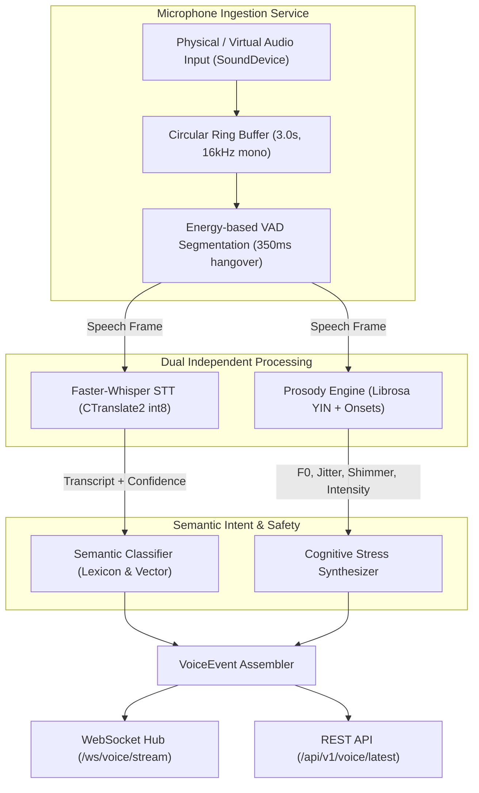

# DCRG Phase 3 – Voice Recognition and Prosody Analysis Engine

> **Document ID:** DCRG-DOC-P3-001  
> **Status:** Completed Phase 3 Deliverable  
> **Modules Covered:** `backend/app/modules/voice_engine/`, `backend/app/modules/prosody_engine/`, `backend/app/modules/semantic_engine/`

---

## 1. Executive Summary

Phase 3 implements an independent, low-latency, and fail-safe Voice Recognition and Prosody Analysis Engine for the Dynamic Command Reliability Graph (DCRG) framework.

The subsystem operates in complete architectural isolation from the Phase 2 joystick subsystem, ensuring that acoustic ingestion, local automatic speech recognition (ASR), prosodic acoustic feature extraction, and intent classification do not block, corrupt, or alter joystick processing.

---

## 2. Architecture & Subsystem Components

### 2.1 Microphone Ingestion (`microphone_service.py`)
- **Library:** `sounddevice` (PortAudio wrapper)
- **Sample Rate:** $16,000 \text{ Hz}$ (Native sample rate for Whisper acoustic feature extractor)
- **Channel Format:** Single-Channel (Mono) 32-bit floating point Linear PCM
- **Buffering:** Thread-safe `RingBuffer` holding a sliding 3.0-second context (48,000 samples)
- **Device Management:** Dynamically queries available host audio hardware, reports names and IDs, and permits runtime device selection.
- **Microphone Status States:**
  - `CONNECTED`: Active audio stream capturing live frames.
  - `DISCONNECTED`: Audio stream stopped; hardware released.
  - `MUTED`: Stream active but frames zeroed out to guarantee privacy.
  - `ERROR`: Hardware unplugged, permission denied, or OS driver error.
- **Privacy Invariant:** Raw audio frames are never written to permanent disk storage by default.

### 2.2 Local Speech-to-Text Engine (`whisper_service.py`)
- **Inference Runtime:** `faster-whisper` based on CTranslate2 quantized execution.
- **Default Model Tier:** `tiny.en` for ultra-low latency CPU execution ($<450\text{ms}$), configurable to `base.en`, `small.en`, etc.
- **Quantization:** `int8` CPU quantization with thread pool optimization.
- **Decoding Configuration:** Greedy decoding (`beam_size=1`) pre-conditioned with canonical control vocabulary prompt.
- **Confidence Computation:**
  $$P(\text{confidence}) = \min\left(1.0, \max\left(0.0, e^{\text{avg\_logprob}}\right)\right)$$

### 2.3 Semantic Intent Classifier (`classifier.py`)
- Normalizes raw transcripts (lowercase, strips non-apostrophe punctuation, trims whitespace).
- Maps operator utterances into five canonical operational primitives:
  - `FORWARD` $\to \vec{V} = (0.0, +1.0)$
  - `BACKWARD` $\to \vec{V} = (0.0, -1.0)$
  - `LEFT` $\to \vec{V} = (-1.0, 0.0)$
  - `RIGHT` $\to \vec{V} = (+1.0, 0.0)$
  - `STOP` $\to \vec{V} = (0.0, 0.0)$
- Defensive States:
  - `UNCERTAIN`: Speech confidence below threshold ($<0.60$) or contradictory commands.
  - `UNKNOWN`: Unsupported out-of-lexicon utterances.
- **Binding Rule:** Never guess a command from unclear or low-confidence speech.
- **Emergency Priority Rule:** A shouting or loud STOP command is never rejected due to elevated pitch or loudness.

### 2.4 Prosody Analysis Engine (`analyzer.py`)
- **Library:** `librosa` (YIN fundamental frequency tracking, onset tempo analysis, RMS energy)
- Extracts Fundamental Frequency ($F_0$), period jitter, amplitude shimmer, speech rate, and loudness intensity.
- Computes synthesized cognitive stress index $S_{\text{stress}} \in [0.0, 1.0]$.
- **Safety Rule:** Prosody is purely an advisory context signal. High stress NEVER independently proves error or invalidates commands.

---

## 3. Backend REST & WebSocket Integration

### REST Endpoints (`/api/v1/voice/`)
| Method | Endpoint | Description |
| :--- | :--- | :--- |
| `GET` | `/api/v1/voice/status` | Returns microphone connection state, active STT model, sample rate, and latest event. |
| `GET` | `/api/v1/voice/devices` | Discovers and enumerates host input audio devices. |
| `POST` | `/api/v1/voice/start` | Starts microphone audio capture. |
| `POST` | `/api/v1/voice/stop` | Stops microphone audio capture and releases device. |
| `POST` | `/api/v1/voice/mute` | Toggles or sets microphone mute state. |
| `POST` | `/api/v1/voice/select-device` | Changes the active audio input device index. |
| `GET` | `/api/v1/voice/latest` | Returns the latest validated `VoiceEvent`. |
| `POST` | `/api/v1/voice/process-audio` | Ingests and processes a synthetic or client-uploaded audio buffer. |

### WebSocket Telemetry Endpoint (`/ws/voice/stream`)
- **Downstream:** Broadcasts real-time `VOICE_EVENT` packets containing transcript, classified command, confidence, and prosody metrics.
- **Upstream:** Accepts control frames (`START_MIC`, `STOP_MIC`, `SET_MUTE`, `PING`).

---

## 4. Frontend Voice Recognition Dashboard Panel

The frontend dashboard includes a dedicated `VoiceDashboardPanel`:
- Real-time visual microphone status badge (`CONNECTED`, `DISCONNECTED`, `MUTED`, `ERROR`).
- One-click Start/Stop capture and Mute controls.
- Dynamic input device selection dropdown.
- Large, unmistakable recognized command badges with directional indicators.
- STT recognition confidence and semantic classification confidence progress meters.
- Acoustic Prosody metric cards: Pitch F0 (mean & std), Speech Rate (syl/s), Period Jitter (%), Amplitude Shimmer (%), and Loudness Intensity (%).
- Cognitive stress index with nominal/elevated classification.
- Recent command history log with chronological timestamps.

