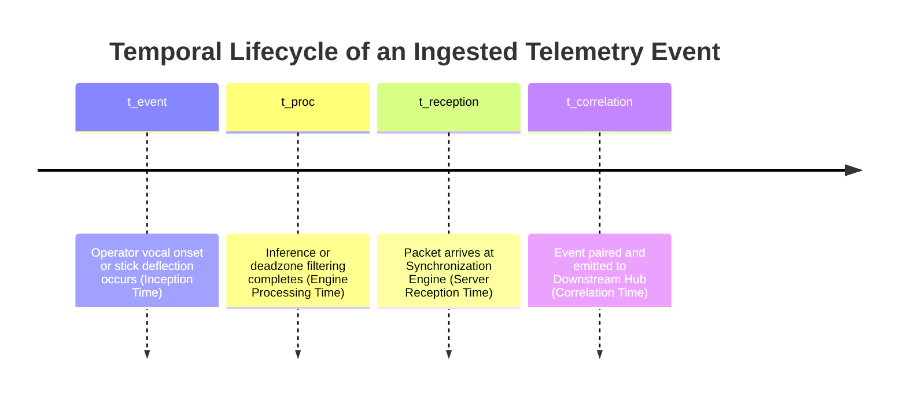

# Timestamp Management & Temporal Normalization Specification

> **Document ID:** DCRG-DOC-P4-002  
> **Status:** Completed Phase 4 Deliverable  
> **Modules Covered:** `backend/app/modules/sync_engine/timestamp_service.py`

---

## 1. Distinction Between Event Time and Reception Time

A core principle of the DCRG synchronization architecture is the strict differentiation between the moment an operator initiates an action and the moment the processing node ingests the resulting telemetry packet:

1. **Event Inception Time ($t_{\text{event}}$):**
   - The authoritative wall-clock timestamp (Unix Epoch UTC in milliseconds with sub-millisecond precision) representing physical action initiation.
   - For Voice: The VAD speech onset boundary.
   - For Joystick: The physical HID polling frame time.
2. **Server Reception Time ($t_{\text{reception}}$):**
   - The UTC epoch timestamp recorded by the backend upon packet receipt at the API or WebSocket interface.
3. **Monotonic Snapshot ($t_{\text{mono}}$):**
   - High-resolution hardware monotonic clock (`time.monotonic_ns()`). Immune to NTP steps, leap seconds, or OS wall-clock adjustments. Used for high-precision latency calculations:
     $$\Delta t_{\text{latency}} = t_{\text{reception}} - t_{\text{event}}$$

---

## 2. Invariant: Immutability of Original Timestamps

> **BINDING ARCHITECTURAL RULE:**  
> **The Synchronization Engine must NEVER silently overwrite, replace, or fabricate an event timestamp.**  
> - If an event arrives with missing or invalid timestamps, it must be flagged with `INVALID_TIMESTAMP` status and preserved in the audit log.
> - Never synthesize a fake timestamp to force a match.

---

## 3. Timestamp Validation & Sanitization

Every incoming event passes through deterministic validation before buffer entry:

| Validation Rule | Boundary Condition | Error Response |
| :--- | :--- | :--- |
| **Missing Timestamp** | `ts is None` or non-numeric | Status: `INVALID_TIMESTAMP`; reason: `"Missing timestamp"` |
| **Non-finite Values** | `math.isnan(ts)` or `math.isinf(ts)` | Status: `INVALID_TIMESTAMP`; reason: `"NaN or Inf detected"` |
| **Historical Corruption** | $t_{\text{event}} < 1.700 \times 10^{12} \text{ ms}$ (pre-Nov 2023) | Status: `INVALID_TIMESTAMP`; reason: `"Older than epoch threshold"` |
| **Absurd Future Value** | $t_{\text{event}} > t_{\text{server}} + 600,000 \text{ ms}$ (+10 min) | Status: `INVALID_TIMESTAMP`; reason: `"Exceeds server time + 10m"` |

---

## 4. Clock Drift and Out-of-Order Packet Handling

### 4.1 Clock Drift Estimation
Because virtual joysticks or distributed sensors may execute on external browsers with unsynchronized clocks, drift is estimated as:
$$\text{Drift}_{\text{est}} = t_{\text{event}} - t_{\text{reception}}$$
If $|\text{Drift}_{\text{est}}| > 50 \text{ ms}$, the event is tagged with an elevated drift warning in `TimestampMetadata`.

### 4.2 Out-of-Order Sequence Detection
The service tracks the highest observed $t_{\text{event}}$ per modality:
$$\text{IsOutOfOrder} = (t_{\text{event}} < t_{\text{last\_seen},\text{modality}})$$
Out-of-order packets arriving within the sliding buffer window are inserted into their chronological position in the priority queue rather than dropped, ensuring resilience to network packet re-ordering.

