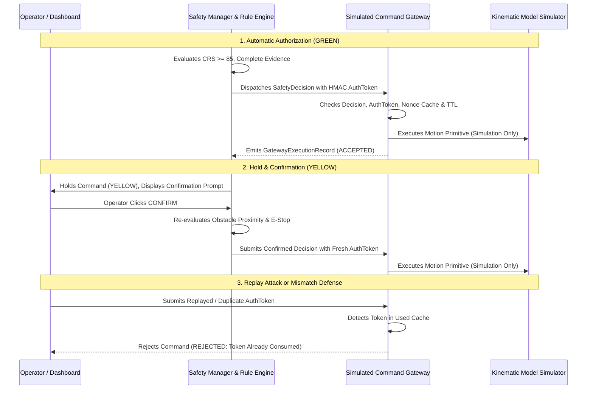

# DCRG Phase 6: Simulated Command Gateway Specification

> **Module:** `app.modules.safety_engine.gateway`  
> **Status:** Operational Implementation  
> **Safety Invariant:** Simulation Only (Zero Actuator Connectivity)  

---

## 1. Overview and Responsibilities

The **Simulated Command Gateway** (`SimulatedCommandGateway`) is the final software boundary between safety authorization and robot simulation. No movement primitive can be enacted in simulation without passing gateway validation.



---

## 2. Gateway Security & Integrity Checks

Every command submitted to `/api/v1/safety/gateway/execute` or auto-dispatched by the manager undergoes 8 sequential integrity gates:

1. **Simulation Guard:** Verifies `SAFETY_GATEWAY_SIMULATION_ONLY = True`. Any attempt to bind to physical motors raises an unrecoverable exception.
2. **State Filter:** Rejects decisions in `EMERGENCY` or `RED` state outright.
3. **Unresolved Hold Filter:** Rejects commands still in `HOLD_PENDING_CONFIRMATION`.
4. **Decision Status:** Verifies `authorization_decision == AUTHORIZED`.
5. **Command Matching:** Strictly verifies that the attempted command matches `authorized_command`. (e.g. attempting `"RIGHT"` when authorized for `"LEFT"` is rejected).
6. **Time-To-Live (TTL):** Verifies `now_ms <= expires_at_ms` (TTL default: $2000\text{ ms}$). Stale tokens are rejected.
7. **Cryptographic Signature Verification:** Verifies presence of a valid HMAC-SHA256 signature token.
8. **Replay Attack Defense:** Verifies that the `auth_token` has not been consumed previously. Once a token is used, it is placed in an in-memory used cache.

---

## 3. Gateway Audit Record (`GatewayExecutionRecord`)

Every dispatch produces an immutable audit record:

```json
{
  "execution_id": "6cf15784-dad9-4342-8542-8202c09df22f",
  "decision_id": "77db5897-d9cf-4d81-b988-d6c32bea9728",
  "command": "FORWARD",
  "accepted": true,
  "timestamp_ms": 1730851200250.0,
  "reason": "SIMULATION MOTION AUTHORIZED: Command 'FORWARD' dispatched to simulated kinematic model.",
  "auth_token": "e3b0c44298fc1c149afbf4c8996fb92427ae41e4649b934ca495991b7852b855"
}
```

