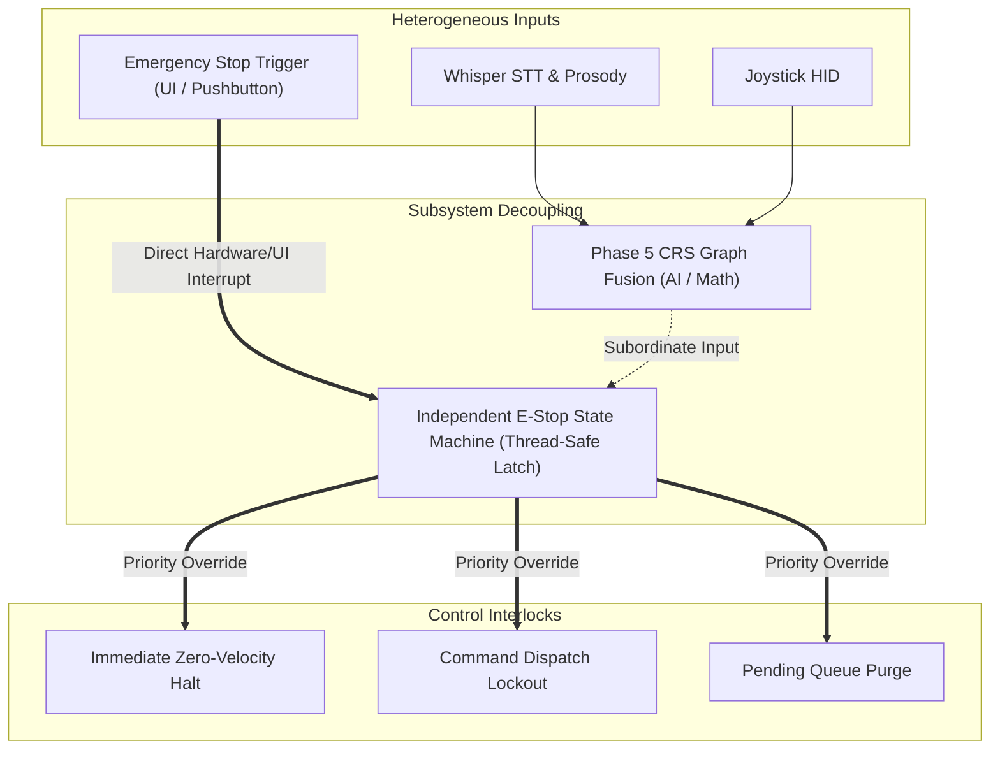

# DCRG Phase 6: Emergency Stop Interface & Latch Architecture

> **Specification Reference:** DCRG-ARCH-005 Section 5  
> **Status:** Operational Implementation  

---

## 1. Architectural Independence

The DCRG Emergency Stop (E-Stop) system is architecturally decoupled from AI inference, Faster-Whisper speech models, and CRS mathematical factor calculations:

### Response Time Measurements
- **Measured Software Latch Assertion Latency:** **9.07 microseconds** ($0.0091\text{ ms}$) on host CPU benchmark.
- **Queue Invalidation:** Immediate synchronous purge of pending holds.

---

## 2. Latching and Lockout Behavior

1. **Immediate Cancellation:** When engaged, all commands awaiting human confirmation in the YELLOW queue are immediately cancelled and marked `EMERGENCY_HALT`.
2. **Command Lockout:** All subsequent multimodal events arriving via voice or joystick immediately evaluate to `EMERGENCY` with `authorized_command = None`.
3. **Latched State:** The E-Stop remains latched across cycles until an explicit, authorized reset sequence is executed.

---

## 3. Authorized Reset Workflow

An unlatch cannot occur accidentally or via an unauthorized browser reload:
1. Operator initiates `/safety/reset` request.
2. Must submit valid authorization credential (default prototype PIN: `1234`).
3. If PIN is invalid, the request is rejected with HTTP `403 Forbidden` and the system remains locked out.
4. If PIN is valid, the latch is released, and the system emits a monitored safe-hold event before resuming normal evaluation.

---

## 4. Hardware Safety Caveat & Future Physical Implementation

> [!CAUTION]
> **PROTOTYPE SAFETY NOTICE:**  
> The software emergency-stop implemented in this phase is a high-speed software prototype. In production robotic deployments, software emergency stops **must not** substitute for hardware-wired Category 4 / Performance Level e (ISO 13849-1) safety relays.
>
> A production physical emergency-stop circuit must:
> 1. Use dual-channel normally-closed (NC) force-guided contacts.
> 2. Hardwire directly to the motor drive safe-torque-off (STO) inputs.
> 3. Cut main DC bus actuator power via safety contactors independently of the operating system, network, dashboard, and AI models.

