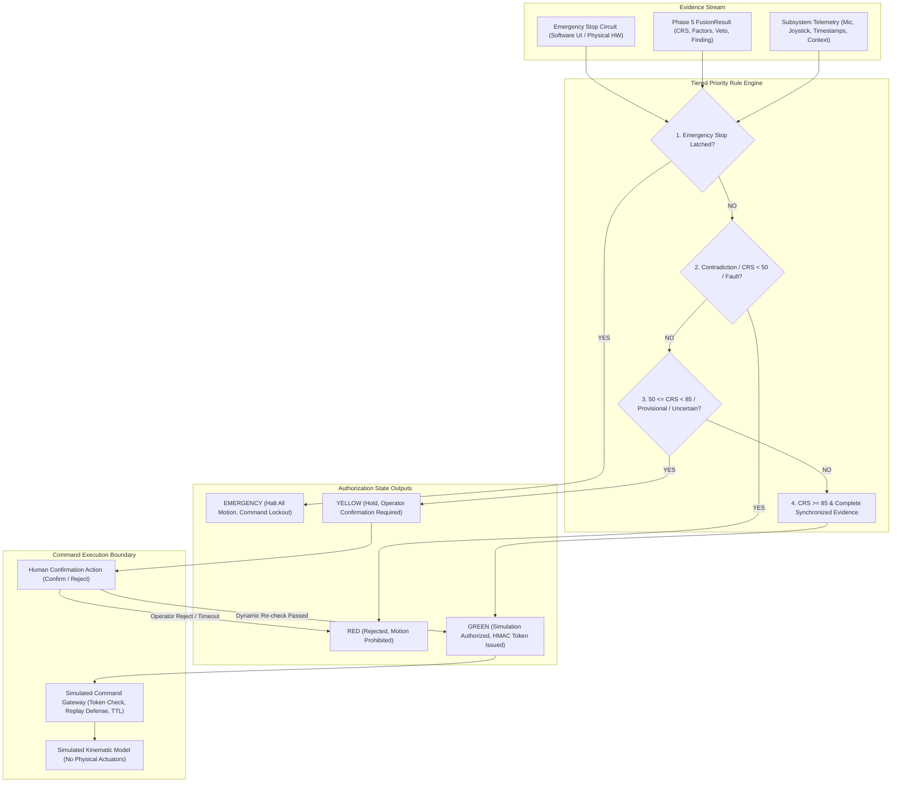

# DCRG Phase 6: Tiered Safety Authorization Engine Specification

> **Module:** `app.modules.safety_engine`  
> **Phase:** 6 (Tiered Safety Authorization Engine)  
> **Status:** Operational & Interlocked  
> **Specification Compliance:** DCRG-ARCH-005, DCRG-ARCH-011  

---

## 1. Executive Purpose & Scope Boundaries

The **Tiered Safety Authorization Engine** serves as the supreme decision gatekeeper of the Dynamic Command Reliability Graph (DCRG) architecture. It receives multi-factor evidence evaluations from the Phase 5 Fusion Engine and determines whether motion commands are authorized for simulation dispatch, held for human confirmation, or rejected.

### Strict Non-Actuation Invariant
- **Simulation Only:** This prototype executes commands within a simulated environment.
- **Physical Actuators Disconnected:** Physical robot motors, relays, and servo drives are **NOT** connected.
- **Non-Certification Disclosure:** This software is an experimental prototype and is **NOT certified** as an ISO 13849-1, IEC 61508, or ISO 10218 safety-critical emergency-stop circuit.

---

## 2. Four Authorization States

| State | Entry Conditions | Decision Output | Command Action |
| :--- | :--- | :--- | :--- |
| **`GREEN`** | $\text{CRS} \ge 85.0$, complete evidence, valid inputs, synchronized within $150\text{ ms}$, zero contradictions, context clear. | `AUTHORIZED` | Dispatches command with cryptographic signature token (TTL: $2000\text{ ms}$). |
| **`YELLOW`** | $50.0 \le \text{CRS} < 84.9$, unpartnered/provisional evidence, or `UNCERTAIN` classification. | `HOLD_PENDING_CONFIRMATION` | Command held in pending buffer for up to $5000\text{ ms}$. Requires operator confirmation. |
| **`RED`** | Contradiction detected, $\text{CRS} < 50.0$, sensor/mic/joystick error, stale timestamp, or boundary violation. | `REJECTED` | Command dropped immediately. Movement strictly prohibited. |
| **`EMERGENCY`** | Software or physical E-Stop button depressed. | `EMERGENCY_HALT` | Immediate zero-velocity halt. Command queue purged. Lockout latched until authorized reset. |

